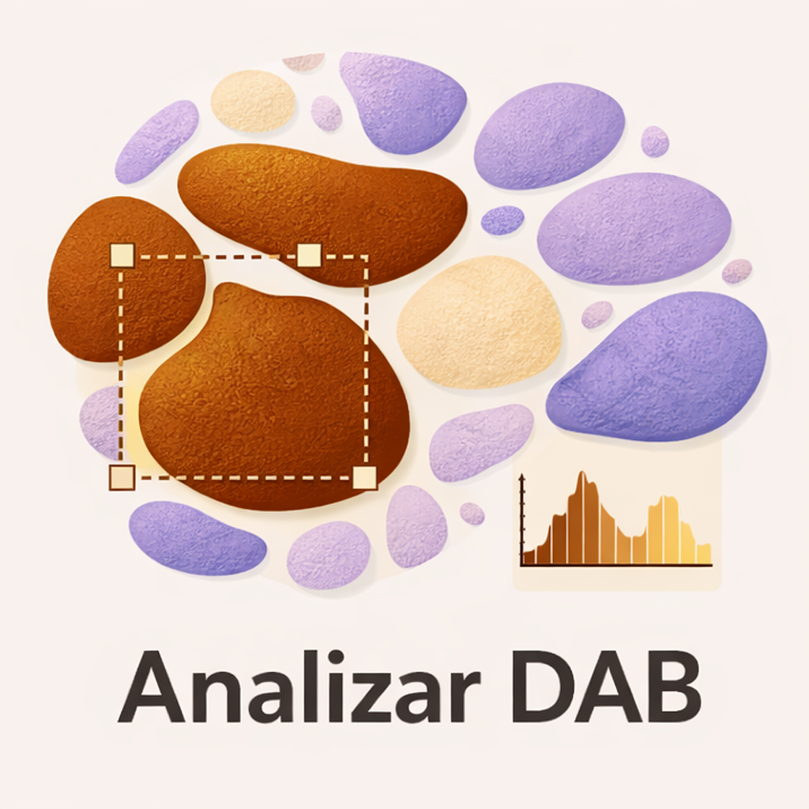

# Analizar DAB

[](https://imagej.net/software/fiji/)
[](LICENSE)
[](https://adoptium.net/)
[](https://doi.org/10.5281/zenodo.23604119)

<div align="center">

</div>

<div align="justify">
  
- Herramienta desarrollada para FIJI/ImageJ que automatiza la cuantificación de la señal de diaminobencidina (DAB) en imágenes de tejido obtenidas mediante microscopía óptica de campo claro.

<div align="center">
  
# Secciones
  
**[](#-descarga)** · **[](#-instalación)** · **[](#-guía-completa)** · **[](#-compilar-desde-el-código)** · **[](#-cómo-citar)** · **[](#-licencia)**

</div>

---

## ⚠️ Requiere FIJI / ImageJ actualizado.
- Descargalo en: [FIJI/ImageJ](https://imagej.net/software/fiji/downloads)

---

## 📥 Descarga

Descargá la última versión del `.jar` desde la sección **Releases** de este repositorio.

- ⬇️ **[Ir a Releases](https://github.com/ezegrondona/Analizar-DAB/releases)**

---

## 🔧 Instalación

1. Descargar el `.jar`.
2. Copiarlo en la carpeta `plugins/` de tu instalación de FIJI.
3. Reiniciar FIJI.
4. El plugin aparecerá en el menú `Plugins`.

---

## 📋 Guía Completa

Las dos guías se abren en el navegador, sin descargar nada:

- 📘 **[Guía de Uso](https://github.com/ezegrondona/Analizar-DAB/blob/main/docs/Gu%C3%ADa%20de%20Uso%20-%20Analizar%20DAB.pdf)**
- 📐 **[Guía de Calibración de FIJI/ImageJ](https://github.com/ezegrondona/Analizar-DAB/blob/main/docs/Gu%C3%ADa%20de%20Calibraci%C3%B3n%20FIJI-ImajeJ.pdf)**

También desde los botones **GUÍA DE USO** y **CALIBRAR** del propio plugin.

Las **guías viajan dentro del `.jar`**, así que los botones del complemento
las abren con tu lector de PDF, sin internet y sin depender de que esta
dirección siga existiendo. Los enlaces de arriba quedan para consultarlas
desde la web.


---

## 🧭 Análisis por sectores

Por omisión, la determinación se hace sobre la imagen completa.

La casilla **Sectorizado**, en la ventana principal, permite limitarla a una
región: con ella activada, el complemento se detiene en cada imagen y pide
que dibujes el área a analizar —con la herramienta de polígonos, por
ejemplo—. Sirve, entre otras cosas, para separar regiones dentro de un mismo
corte y medirlas por separado.

El cartel que lo pide **no bloquea la imagen**: podés dibujar con él en
pantalla. Si presionás OK sin haber seleccionado nada, se analiza la imagen
completa.

**Se pueden seleccionar varias regiones a la vez.** Mantené **Shift** al
dibujar las siguientes para sumarlas, o **Alt** para restarlas. La medición se
aplica al conjunto: el área es la suma de las partes y la intensidad, su
promedio ponderado.

La detección de DAB no cambia: sigue clasificando por color en toda la
imagen. Lo que se acota es **qué se mide**.

La planilla incluye una columna **Sector analizado** con el área de la región
elegida, en las mismas unidades que el resto, o *Imagen completa* cuando no se
sectorizó. Así el resultado queda trazable y se pueden comparar sectores de
distinto tamaño.

---

## 👤 Autor

- **Autor:** Dr. Ezequiel Grondona
- **Institución:** Centro de Microscopía Electrónica — UNC / INICSA / CONICET
- **Contacto:** 📧 ezequiel.grondona@unc.edu.ar

---

## 🔨 Compilar desde el código

El complemento es un proyecto Maven. Con Java 8 o superior y Maven
instalados:

```
mvn clean package
```

El `.jar` listo para usar queda en `target/`. Incluye adentro las
bibliotecas que necesita —Apache POI, Log4j y sus dependencias—, así
que se copia a `plugins/` y funciona.

ImageJ no se empaqueta: la aporta la instalación de FIJI donde se
instale el complemento.

---

## 📑 Cómo citar

Si usás Analizar DAB en un trabajo publicado, citalo. Para una
herramienta científica, la cita es lo que permite que el trabajo de
construirla se reconozca y que otro pueda reproducir lo que hiciste.

> Grondona, E., & De Paul, A. L. (2026). *Analizar DAB* [software].
> Centro de Microscopía Electrónica, Universidad Nacional de Córdoba —
> INICSA (CONICET–UNC). https://doi.org/10.5281/zenodo.23604119

El repositorio incluye un archivo [`CITATION.cff`](CITATION.cff):
GitHub lo lee y muestra el botón **«Cite this repository»** arriba a
la derecha, que da la cita ya formateada en APA y en BibTeX.

**Sobre el DOI.** El de arriba es el *concept DOI*: apunta siempre a
la versión más reciente, así que una cita hecha hoy sigue sirviendo
cuando se publique una versión nueva. Si necesitás citar una versión
puntual —por ejemplo para que otro reproduzca exactamente tu análisis—
cada una tiene el suyo, listado en la solapa *Versions* del
[registro en Zenodo](https://doi.org/10.5281/zenodo.23604119).

---

## 📄 Licencia

**BSD 3-Clause.** Podés usar, modificar, redistribuir e incluso vender
obras derivadas, con dos condiciones: conservar el aviso de copyright
y la licencia, y no usar el nombre del autor ni el de la institución
para promocionar derivados sin permiso. El texto completo está en
[`LICENSE`](LICENSE).

El `.jar` que se distribuye empaqueta bibliotecas de terceros que
conservan sus propias licencias, todas permisivas y compatibles. Están
detalladas en [`THIRD-PARTY-NOTICES.txt`](THIRD-PARTY-NOTICES.txt).

</div>
